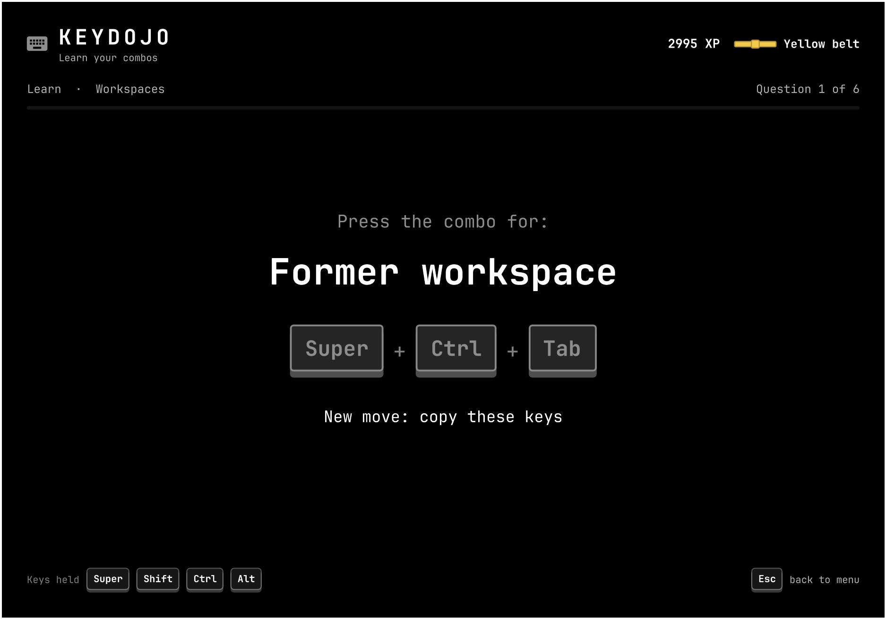
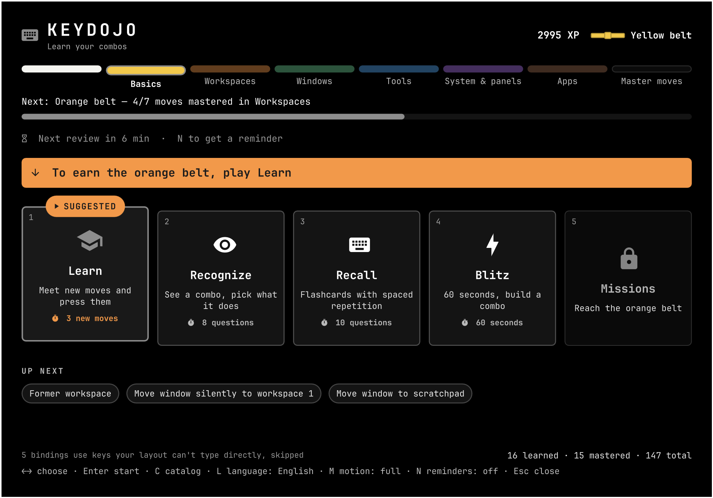
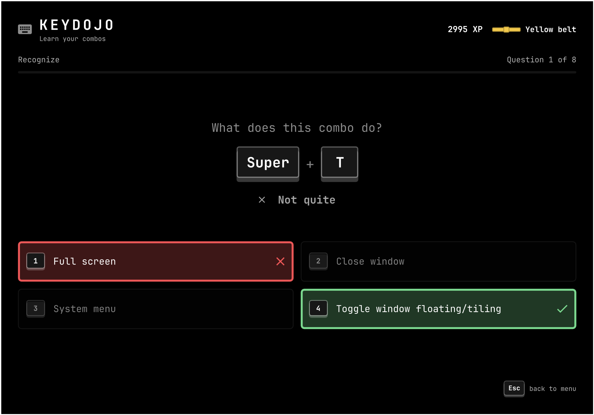

# Keydojo

**Learn your combos.** A keybinding trainer for [Omarchy](https://omarchy.org). Keydojo reads **your**
keybindings (Omarchy defaults plus your own overrides) and turns them into a
short, friendly game that runs as a native Omarchy shell overlay.



## How it plays

You climb belts, white to black. Each belt covers one group of shortcuts:
Basics → Workspaces → Windows → Tools → System & panels → Apps → Master moves.
You earn a belt by mastering 80% of its moves, and new game modes unlock as you go:

| Mode | Unlocks | What you do |
|------|---------|-------------|
| **Learn** | from the start | Meet 5 new moves, press each one, then a quick check |
| **Recognize** | 4 moves learned | See a combo, pick what it does (1–4) |
| **Recall** | 6 moves learned | Flashcards with spaced repetition: press the combo from memory |
| **Blitz** | yellow belt | 60 seconds, streaks build a ×5 multiplier |
| **Missions** | orange belt | Keydojo hides and watches Hyprland while you do it for real: open a terminal, send it to workspace 7, follow it, close it… |



## How it teaches

Keydojo leans on a few well-studied memory effects:

- **Retrieval over rereading.** Recall makes you produce the combo from
  memory, which sticks better than picking it from a list.
- **Spacing.** A new move comes back after 10 minutes, then 30 minutes, then
  1, 3 and 7 days. The first two steps can be climbed in one sitting; after
  that a move only levels up when it is due again.
- **Speed.** A move counts as mastered only when it comes out right in under
  2.5 seconds. Shortcuts pay off once they are automatic.
- **Confusable choices.** In Recognize the wrong answers are moves you already
  know that look like the right one: same key with other modifiers, or the
  same modifiers on another key.

There are no notifications and no streaks. Keydojo never calls you back; it
shows what is due when you open it.



While a quiz is open, Hyprland is switched to an empty `keydojo` submap, so
pressing `Super+Enter` reaches the game instead of opening a terminal. Wrong
answers tell you what that combo actually does.

Keys are matched by physical position and labelled with your layout, so on
an Italian keyboard you see `Super + '` rather than `Super + MINUS`. Bindings
your layout can't type directly (for example `/` or `[` on Italian) are
skipped and counted on the home screen.

English and Italian are built in. Press `L` on the home screen to switch.

## Install

```bash
omarchy plugin add https://github.com/shredder32/omarchy-keydojo.git --enable
```

Then bind it, for example in `~/.config/hypr/bindings.lua`:

```lua
o.bind("SUPER + CTRL + ALT + K", "Keydojo", "omarchy-shell shell toggle io.github.shredder32.keydojo")
```

Or open it once with `omarchy-shell shell toggle io.github.shredder32.keydojo`.

## Uninstall

```bash
omarchy plugin remove io.github.shredder32.keydojo
```

Then delete the keybinding you added to `~/.config/hypr/bindings.lua`, and,
if you want to forget your progress too, `~/.local/state/keydojo/`.

## Safety

- `Esc` leaves any screen; on the home screen it closes Keydojo.
- `Super+Ctrl+Alt+Esc` always releases the keyboard and closes Keydojo.
- `bin/keydojo-guard` resets the submap automatically if the overlay vanishes
  while capturing (a shell crash or reload).
- Missions never ask for destructive actions (close all, lock, power) and
  clean up the windows they open.

Progress lives in `~/.local/state/keydojo/progress.json`.

## Requirements

Omarchy with the Quickshell-based `omarchy-shell` and Hyprland's Lua config
(0.56+). External tools used at runtime, all shipped with Omarchy: `hyprctl`,
`jq`, `xkbcli` (from libxkbcommon), `flock` and `setsid` (util-linux).

Keydojo does not change your configuration. It only adds a temporary
Hyprland submap at runtime while a quiz is open.

## Development

The pure logic (`Engine.js`, `Keymap.js`, `I18n.js`, `Missions.js`) runs under
node:

```bash
omarchy menu keybindings --print > /tmp/print.txt
bin/keydojo-keymap > /tmp/xkb.txt
node tests/engine.test.js /tmp/print.txt /tmp/xkb.txt
```

Qt caches imported QML components, so after editing a component other than
`KeyDojo.qml`, run `omarchy-restart-shell`.

## Translations

All UI text lives in `I18n.js`: `STRINGS` holds the interface and mission
texts per language, `DESC_IT` translates Omarchy's binding descriptions. To
add a language, copy the `en` block under a new code and translate it; the
node test above fails if any key is missing.

## License

MIT
